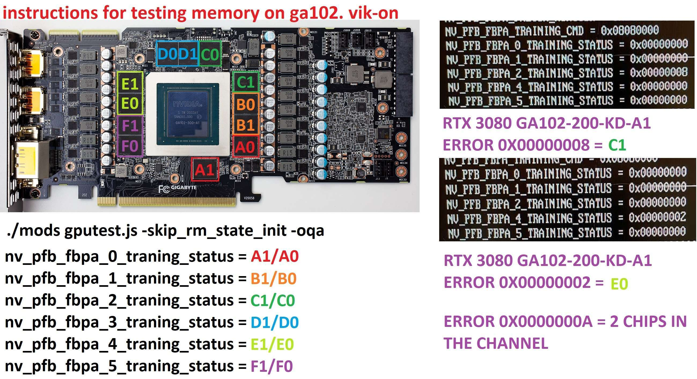
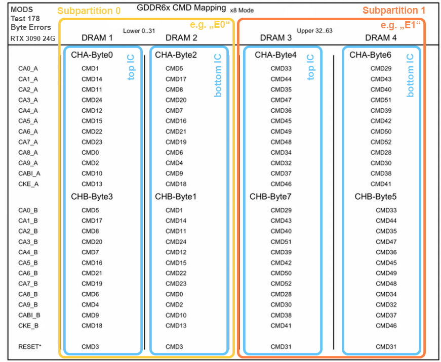
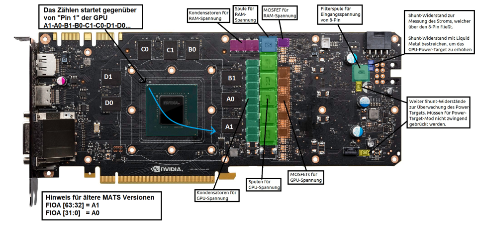
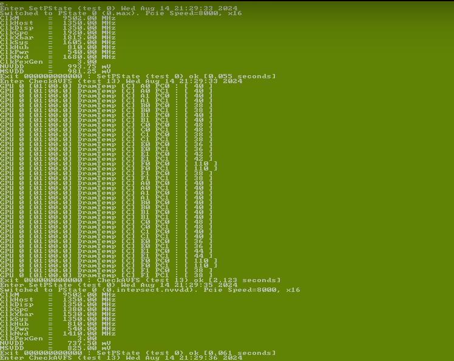
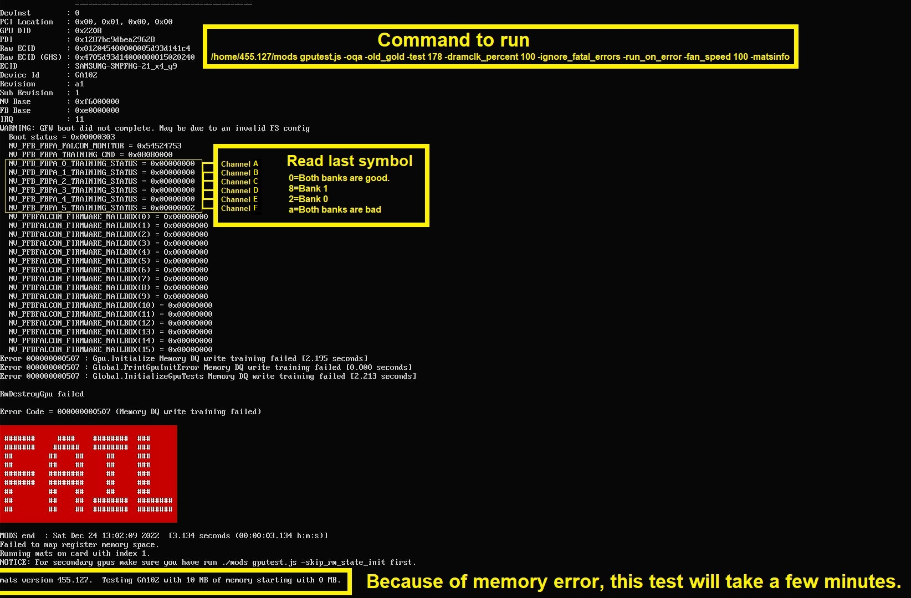
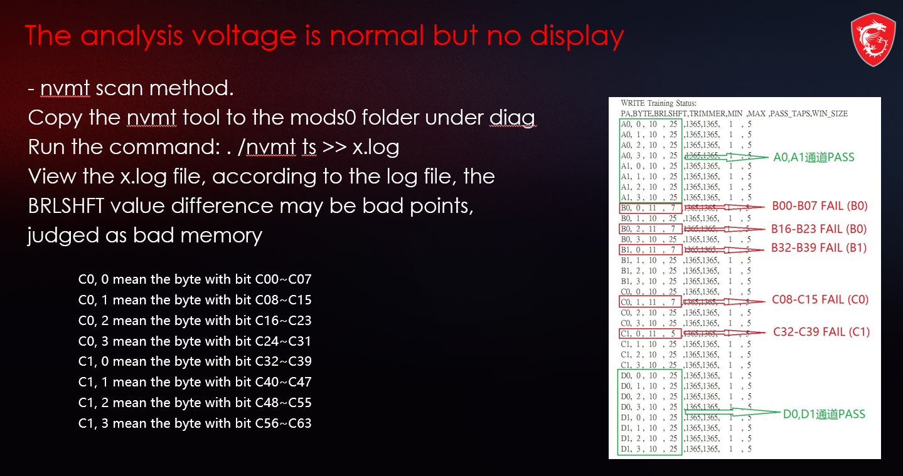

# Анализ каталогов `MATS_MODS_NVMT` и `455.219` — фирменная диагностика памяти NVIDIA

> Что это, как устроено, кому подходит и — критично для этого проекта —
> **поддерживает ли оно GA102 (CMP 90HX)**.
>
> Короткий ответ: `MATS_MODS_NVMT` (MATS 400 + nvmt 2.0) — **только Turing/GA100-GA101,
> GA102 нет**. Но два других артефакта закрывают пробел полностью:
> пакет **`455.219`** (MODS/MATS ветки 455, payload, ноябрь 2021) — золотой образ
> `gldGA102.bin`; и Rufus-образ **«MODS From 60GB»** (январь 2023) — готовый
> загрузочный USB с MODS 455 ×4 сборки и **nvmt 2022, где GA102 = YES** (вместе с
> nvmt-брингапом: пины, тренинг, AC). Это полный набор диагностики для 90HX.

---

## 1. Состав каталога

```text
MATS_MODS_NVMT/
├── MATS_400.iso        482 МБ — загрузочный образ NVIDIA Field Diagnostics (TinyLinux + MODS 400.281.2)
└── nvmt_2000/          471 КБ — консольная утилита memory bring-up (NVMT 2.0.0.0)
    ├── nvmt            Linux ELF x86-64 (не стрипнут), Apr 2022
    ├── nvmt.fid        «BUS=1 DEV=0 FUNC=0» — BDF целевой карты
    ├── mt.sh           обёртка: полный прогон с логом в mt.log
    ├── mt-out.sh       сама последовательность команд nvmt
    └── NVMT_Aug2020_supported GPUs.txt  таблица поддержки чипов
```

## 2. MATS_400.iso изнутри (ISO 9660, загрузочный, метка `MATS_400`)

| Часть | Содержимое |
|---|---|
| Загрузка | SYSLINUX (BIOS) + `EFI/BOOT/BOOTX64.EFI` (UEFI). Аппенд: `nodhcp noutc waitusb=0 iommu=off pcie_aspm=off` — диагностика в максимально «сыром» PCIe-режиме |
| ОС | `/TINY`: NVIDIA TinyLinux (Gentoo-based, ядро 4.5 МБ, initrd, squashfs 94 МБ). Работает из RAM, ничего не пишет на хост |
| Движок | `/HOME/400.281.2/`: `MODS` (25.3 МБ — главный диагностический движок), `MATS` (обёртка memory-теста), `LIBNVIDI.SO` |
| Тесты | `.JSE` — зашифрованные MODS-скрипты (не читаются без движка), `.SPC` — профили запуска (mfg/field/DGX/Tesla), `CUDA.BIN` — CUDA-бинарник для CUDA-тестов |
| Чипы | `.XME` (GF10x–GM20x) и `.JSO` (GP10x, TU10x) + «золотые» образы памяти `GLD*.BIN` (GP100–GP108, TU102–TU117) |
| Автозапуск | `/TINY/COMMANDS`: при каждой загрузке сам выполняет `runmats` → `mods gputest.js -test 275` (память) → `mats -e 20` → лог `mats.log` → звуковой сигнал. Полностью автономный цикл «загрузился — протестировался — вытащи флешку» |

### Критический факт: покрытие чипов MODS 400

В дереве ISO **нет ни одного файла GA10x** (`GA10x_F.JSO` отсутствуют, в бинаре MODS
строк `GA10x` нет). Верхняя граница поддержки — **Turing (TU117) + GV100**.
MODS-ветка 400 — это Turing-эра; Ampere обслуживается ветками 500+.

## 3. nvmt_2000 изнутри

`nvmt` — консольная утилита NVIDIA memory bring-up (используется производителями
плат для инициализации/валидации GDDR). Не стрипнут, команды читаются из строк:

| Группа | Команды |
|---|---|
| Инвентаризация | `p` (probe), `gputemp`, `ecid`, `gddrinfo` (MR3), `clk`, `i` (FBIO-регистры), `cmdmap` |
| Калибровка/тренинг | `trainstatus`, `calstatus`, `dramtrain x` (форс-тренинг), `bgcal`, `ac x y` (AC-тайминги), `char` (characterization) |
| Тестирование пинов | `g6ca` (GDDR6 CMD-пины) — то, что нужно после реболлинга |
| Нагрузка/счётчики | `fb` (чтение/запись FB по адресу), `fbcnt` (утилизация RD/WR), `ecccnt`/`edccnt` (ECC/EDC), `falmon` |
| Скрипт `mt-out.sh` | последовательность: probe → temp → `mc` → `ac` → `mc5` → `i` → `trainstatus` → `cmdmap` |

### Критический факт: покрытие чипов nvmt 2.0

Встроенная таблица поддержки (и прилагаемый `NVMT_Aug2020_supported GPUs.txt`):

| Чип | MODS | NVMT |
|---|---|---|
| TU102/TU104/TU106/TU116/TU117 | 400 | YES |
| GV100 | 384 | YES |
| **GA100, GA101** | — (нет в MODS 400) | **YES** |
| **GA102** | **нет** | **нет** |
| GP10x и старше | да | да |

**GA102 отсутствует в обоих инструментах.** ⚠️ Однако в Rufus-образе (§6) лежит
**более новый nvmt (2022, «3000-4090»)**, где таблица поддержки уже включает
GA102/GA103/GA104/GA106/GA107, AD102 (4090) и GH100 — брингап-функции для GA102
доступны именно через него.

## 4. `455.219` — payload MODS/MATS ветки 455 (Ampere): **GA102 поддержан**

`E:\GIT\CMP90HX\455.219\455.219\` — 147 файлов, ~311 МБ, даты: авг–дек 2021.
Это **не загрузочный ISO, а payload** диагностического пакета (то, что в MATS_400.iso
лежало в `/HOME/400.281.2/`) — для раскладки на TinyLinux 19.02.1 / PXE.

| Компонент | Что это |
|---|---|
| `mods` (44 МБ) | Движок MODS 455.219 (статический ELF, запакован — строки не читаются) |
| `mats` | Обёртка memory-теста |
| **`gldGA102.bin`** (2.1 МБ) | **Золотой образ памяти GA102** (в шапке строка версии `455.219`) — маркер поддержки GA102 |
| `frb_ga100.bin`, `fub_ga100.bin` | Fuse/регистровые блобы GA100 |
| `driver.tgz` | **GPL-исходники ядрового драйвера MODS** (`mods_krnl.c`, `mods_mem.c`, …) — можно собрать под любое ядро, не только TinyLinux 19.02.1 |
| `nvflash` (9.5 МБ, дек 2021) | Свежий флешер VBIOS — полезен для 20GB-мода (шаг BCT) |
| `cuda.bin`, `librtcore.so`, `nvofa/nvjpg/nvdec.bin` | CUDA/RT/OFA/NVDEC-бинарники Ampere-эпохи |
| `test.sh`, `test.cfg`, `oc.sh`, `gen4.sh`, `.spc`/`.arg` | Единый раннер тестов; спеки под плату **PG136 (G136, A100-класс)**: FCT/DG4/OQA |
| `operator.txt` | Инструкция оператора: **TinyLinux 19.02.1 required**, сначала прошить VBIOS, замечания по охлаждению при dual-board |

### Как это относится к CMP 90HX

* Спеки `.spc` здесь под плату PG136 (A100) — **спеки PG132/CMP 90HX в пакете нет**.
  Но это не блокер: базовый memory-тест запускается **без платового спека**:
  ```bash
  # T275 из test.cfg — стандартный тест памяти на макс. pstate, с EDC-допуском:
  ./mods -no_net -a gputest.jse -test 275 -pstate 0.max \
         -edc_tol 2400 -edc_tol_pertest 2400 -only_pci_dev
  ```
* Запуск: официально — TinyLinux 19.02.1 (скачать соответствующий образ TinyLinux,
  положить payload, `./test.sh`). Альтернатива: собрать `mods.ko` из `driver.tgz`
  под своё ядро (исходники GPL), выгрузить nvidia-драйвер и запускать MODS с хоста.
* `oc.sh` даёт сценарий «память под разгоном + тест 275» (`-bg_power 1000 -dump_stats`)
  — удобно для проверки стабильности BCT после 20GB-мода.
* Ветку 455 выбирали под запуск GA102 (ветка запуска Ampere) — наличие
  `gldGA102.bin` это подтверждает на уровне артефактов.

## 5. Соответствие проекту CMP90HX

| Карта (чип) | MATS_400.iso | nvmt_2000 | MODS 455.219 | Вывод |
|---|---|---|---|---|
| CMP 50HX (TU102) | ✅ полная поддержка (`TU102_F.JSO`, `GLDTU102.BIN`) | ✅ YES | ✅ (Turing в ветке 455 тоже есть) | **Идеально**: оба пакета |
| CMP 90HX (GA102) | ❌ | ❌ (nvmt 2.0) → ✅ (nvmt 2022, §6) | ✅ **memory-тесты через `gldGA102.bin`** (платовых спеков PG132 нет) | **Рабочая диагностика памяти 90HX: MODS 455 + nvmt 2022** |
| CMP 170HX (GA100) | ❌ MODS | ✅ nvmt | ✅ (frb/fub + спеки PG136) | Полный набор |

Примечание: 20GB-валидация в `cmp50hx-unlock` не использовала ни MATS, ни nvmt:
четыре карты проверялись через RM-пробы патченного драйвера
(`REFWSEC_STOCK_WPR_PASS`, `CMP50_GSP_READY`) и контроль `memory.total = 20480 MiB`
с последующим стабильным GSP-бутом. Т.е. даже для 50HX фирменная диагностика —
не обязательный этап.

## 6. Rufus-образ «MODS From 60GB 1-11-2023 with NVMT» — готовый носитель, всё в одном

**Происхождение и целостность (проверено):** первоисточник — тред
[*«Nvidia MATS & MODS USB stick (with NVMT)»*](https://levirepair.eu/infusions/forum/viewthread.php?thread_id=3)
(levirepair.eu, автор levi990e; кредиты: Tech Cemetery discord & DrasticMeasures;
техники отключения каналов — NWR discord & Sander; схемы памяти — GerRepair discord,
f!P[z]y, vik-on). Локальный образ «вырезан из 60GB VRAM test tools» + добавлены
MODS 455/520 для 3060Ti/40xx + NVMT. **MD5 локального .img =
`3cc2ce1e4b9836548a8fad6479a2c4c3` — совпадает с опубликованным на форуме**
(CRC32 15B10F3F) → образ байт-в-байт соответствует релизу автора.
На форуме есть и более новые сборки 2026 г. («RTX series memory testing OS»,
bare-bone syslinux/GRUB-инсталляторы) и зеркала загрузки (1drv.ms / pixeldrain).

`../MODS - NVMT - Rufus/`: образ диска 7.9 ГБ (`MODS From 60GB 1-11-2023 with
NVMT.img`), `rufus-3.21.exe` для заливки на флешку, `Patch notes.txt` (история
сборки: 2022-02 → 2023-01). Требуется флешка ≥ 8 ГБ.

Две FAT32-партиции (MBR, загрузка SYSLINUX: `iommu=off pcie_aspm=off`):

| | Партиция 1 (4.7 ГБ, boot) — актуальные | Партиция 2 (2.9 ГБ) — старые поколения |
|---|---|---|
| ОС | `/TINY`: TinyLinux (kernel+initrd+squash 67 МБ) | — |
| MODS | `/HOME/455.107_3060` (GA106), **`455.120_3080`**, **`455.204`**, **`455.219`** — у 3080/204/219 есть **`gldGA102.bin`** | `367.56.4` (Pascal), `400.179_1660TI`, `400.184_2080TI`, `400.198_1660TI` |
| NVMT | `nvmt_2020aug` (GA100/101/TU10x), **`nvmt_3000_4090` (2022)** | `nvmt_pascal`, `nvmt_2020aug`, `NVMT - 3000-4090` |
| Прочее | `/MODS/…` — DOS-версии для старых карт (8400GS…GTX560, ремонтная коллекция), `/DOS71` (DOS 7.1) | то же |

**Таблица поддержки nvmt 2022 («3000-4090»)** — ключевой артефакт:

| Чип | MODS | NVMT |
|---|---|---|
| **GA102** (3090Ti/3090/3080 = **CMP 90HX**) | **455** | **YES** |
| GA103/GA104/GA106/GA107 | 455 | YES |
| GA100 | 445 | YES |
| AD102 (4090), GH100 (H100) | 520 | YES |
| TU10x / GV100 / GP10x | 400/384/36x | YES |

Скрипты-обёртки автора сборки (в `/HOME`): `mods` — запуск `/home/455.204/mods
gputest.js -oqa -test 118 -fan_speed 60` с прокидыванием доп. аргументов
(`mods -test 275 -loops 10 …`), авто-ротация логов с датой и копированием на
внешний USB; `mats`, `copy`, `modsinit`.

### Практический рецепт для CMP 90HX

1. Залить образ на флешку ≥8 ГБ через Rufus (DD-режим).
2. Загрузиться (Secure Boot off). Логин root без пароля.
3. Тест памяти GA102: `mods -test 275 -pstate 0.max` (или дефолтный
   `mods` = тест 118 + свои ключи). Логи — `mods455-<дата>.log`.
4. Брингап/пины: `/home/nvmt_3000_4090/NVMT - 3000-4090/` → `./mt.sh`
   (проверить `nvmt.fid` — BDF карты).
5. После 20GB-мода: тот же тест 275 до/после + `nvmt trainstatus/calstatus`.

### Инструкция с форума первоисточника (важно для CMP!)

* `mods` тестирует **GPU + память**; `mats` — **только память**.
* **CMP-карты не имеют видеовыходов → это всегда сценарий «GPU как secondary»:**
  нужен хост с iGPU (видео от материнки), затем:
  ```bash
  modsinit          # инициализация secondary-GPU контекста
  mods              # тест GPU+памяти
  mats -n 1         # тест памяти (карта №1)
  ```
  Для карт с видеовыходом (primary): просто `ls` → `mods` / `mats`.
* nvmt-шпаргалка с форума: `nvmt vbios` (показ VBIOS), `nvmt helpme`,
  `nvmt ts` (= trainstatus, `> log.txt` для сохранения), `nvmt p` (устройства).

### Диагностика памяти GA102: от ошибки к физическому чипу

| Инструмент | Команда | Что даёт |
|---|---|---|
| Training status по FBPA | `./mods gputest.js -skip_rm_state_init -oqa` → прочитать `NV_PFB_FBPA_N_TRAINING_STATUS` | Ненулевой бит = отказ канала; для 90HX активны FBPA 0,1,2,4,5 (320 бит, та же топология, что RTX 3080). Карта соответствия FBPA→позиции чипов на плате:  |
| Побайтовый тест | MODS **test 178** (см. `gldGA102`) + карта GDDR6X x8-mode CMD mapping | Байт-ошибки → верхний/нижний IC, subpartition 0/1:  |
| Общая схема памяти MATS | — |  |
| Перегрев чипа | `./mods gputest.js -test 13 -run_on_error -bg_dram_temp 1000` | Лог температур DRAM по чипам → горячий = дохлый:  |
| Тренинг памяти |  | этапы memory training в логе |
| nvmt-анализ |  | чтение статусов |

*(все изображения — локальные копии вложений треда levirepair.eu, `docs/img/levirepair/`)*

### Отключение отказавших каналов (floorsweep) — метод Sander (NWR)

Позволяет оживить карту с одним битым каналом памяти (потеря 2 ГБ на канал
у 3080/90HX-класса) — и помогает при отладке после 20GB-мода:

```bash
./mods gputest.js -oqa -old_gold -dramclk_percent 100 -fan_speed 50 \
    -run_on_error -ignore_fatal_errors -matsinfo
# при необходимости добавить (маска X — отключаемые каналы):
#   -floorsweep fbio_disable:0xXX:fbp_disable:0xXX
```

Маска — битовая OR (бит N = канал N): `A=0x01, B=0x02, C=0x04, D=0x08,
E=0x10, F=0x20`. Пример с форума (E+D+A): **правильно `0x10|0x08|0x01 = 0x19`**.
⚠️ На форуме значения записаны с десятично-шестнадцатеричной путаницей
(«E:0x16», «F:0x32», «25 → 0x25»): `0x25` на самом деле отключит A, C, F.
Проверяйте результат по `NV_PFB_FBPA_*_TRAINING_STATUS` после применения.

### Альтернативный источник и практический опыт: тред buyanigor на VLab

[**Тред «MATS/MODS 400/455/520/570» на vlab.su**](https://vlab.su/viewtopic.php?t=124090&f=48)
(автор buyanigor, с 2022-03, ~900 сообщений) — независимые загрузочные сборки
MODS на TinyLinux (MEGA/Яндекс.Диск). Вычитан полностью — **весь выжим в
полевом справочнике: [MATS_MODS_FIELD_GUIDE.md](MATS_MODS_FIELD_GUIDE.md)**
(версии по чипам, MODS-vs-MATS для GDDR6X, расшифровка TRAINING_STATUS,
рабочие команды, питание VPP 1.8 В, дата-коды Micron, запрет смешивания
вендоров, свап-методика GPU-vs-память, ссылки).

Ключевое отсюда:

* **Подтверждение версий по чипам**: GA10x (в т.ч. GA102/CMP 90HX) → MODS **455**
  (455.127–455.219; нюансы по подверсиям — в справочнике); AD102/GH100 → 520;
  TU10x → 400; Pascal → 367.
* ⚠️ **UEFI vs Legacy — ложные ошибки памяти**: ровные мелкие ошибки по всем
  каналам в UEFI (артефакт режима/фреймбуфера-курсора), в Legacy — чисто.
  Для CMP 90HX: «все каналы понемногу» → сначала Legacy/CSM, потом выводы.
* ⚠️ **MATS для GDDR6X — не вердикт** (пропускает дефекты): основной инструмент
  90HX — MODS (тесты 178/94/3); «MATS PASS» ≠ исправность.


## 7. Как использовать MATS_400 (для 50HX / TU102)

1. Rufus → FAT32 USB (GPT for UEFI; для legacy — `syslinux -m -a`).
2. Распаковать содержимое ISO в корень флешки. Secure Boot — выключить
   (уже выключен для всего стека проекта).
3. Загрузиться: цикл MATS запустится сам, по завершении — бип.
4. Логи: `mats.log`, `mats_mobile.log`, `mods.log` в выходном каталоге.
   Отказ памяти привязывается к FBPA/subpartition → маппинг на конкретный чип GDDR6.
5. nvmt — из уже установленного Linux с картой (целевой BDF в `nvmt.fid`):
   `./mt.sh` даёт полный брингап-лог `mt.log`.

## 8. Чем валидировать память CMP 90HX после 20GB-мода

По убыванию силы доказательства:

1. **MODS 455.219 из `../455.219/` или с Rufus-USB (§6)** — есть `gldGA102.bin`:
   тест 275 через TinyLinux (образ «From 60GB» уже собран) или собранный
   `mods.ko` из `driver.tgz`. Отказ привязывается к FBPA/subpartition →
   конкретный чип.
2. **nvmt 2022 («3000-4090», §6)** — брингап-функции для GA102: `trainstatus`,
   `calstatus`, `g6ca` (CMD-пины), `ecccnt/edccnt` — отбраковка пайки на уровне
   пинов.
2. **RM-пробы патченного драйвера** — путь, подтверждённый cmp50hx-unlock:
   успешный GFW_BOOT/GSP_READY на 20 ГБ + `memory.total = 20480` + долгий
   стресс уже под драйвером.
3. **Стресс-валидация**: `stack/bench.sh` (GEMM 30–60 мин, температуры GDDR6X
   под контролем), memtest-утилиты уровня пользователя, прогон LLM с
   длинным контекстом (весь FB задействован).
4. **ECC/EDC через драйвер** (если включены на карте): `nvidia-smi -q -d ECC`,
   счётчики ошибок после стресса.

## 9. Ограничения и предостережения

* **Происхождение**: MATS/MODS и nvmt — внутренние инструменты NVIDIA для
  полевой диагностики/брингапа, распространение за пределы NVIDIA ограничено
  (копирайт-заголовки в скриптах прямые). Артефакты получены из неофициального
  источника; целостность и отсутствие закладок не проверяемы. Использовать
  только на изолированном стенде, не на машине с чувствительными данными
  (образ грузится из RAM, но всё же).
* `.JSE`-скрипты зашифрованы — модифицировать тесты нельзя, только запускать.
* `mods` запакован — содержимое не верифицируется строками; доверие строится
  на артефактах (`gldGA102.bin` с версией, спеки, driver.tgz с GPL-исходниками).
* ISO грузится с `iommu=off pcie_aspm=off` — ожидаемо для диагностики, но
  не оставляйте такие настройки на обычной загрузке хоста.
* nvmt пишет регистры памяти напрямую — запускать только осознанно,
  `dramtrain`/`ac` могут оставить память в нерабочем состоянии до сброса.
* MODS требует **отсутствия ОС-драйвера NVIDIA** (прямая работа с железом) —
  выгружать `nvidia.ko`/`nouveau` перед запуском.

## 10. Вывод

* `MATS_MODS_NVMT` — качественный набор фирменной диагностики **для Turing и
  GA100/101**, особенно ценный для CMP 50HX-трека.
* `455.219` и Rufus-образ «MODS From 60GB» закрывают пробел GA102 полностью:
  **MODS 455 (тест 275, `gldGA102.bin`) + nvmt 2022 (брингап GA102)**. Для 90HX
  диагностика памяти теперь доступна «из коробки» — образ уже собран, скрипты
  написаны, остаётся залить на флешку через Rufus. Процедура 20GB-мода:
  [docs/20GB_PROCEDURE.md](20GB_PROCEDURE.md) (шаги 1, 6).
* Предостережения (§9) в силе для всех трёх пакетов: внутренние инструменты
  NVIDIA из неофициального источника; Rufus-образ — пересборка сообщества
  (зашифрованные `.JSE`, запакованные бинари, DOS-хлам из ремонтной коллекции
  на тех же партициях) — использовать только на изолированном стенде.
